# Rapport d'EDA — Jev-Darija Telecom

> Rapport généré automatiquement par `dvc repro` (étape `eda`). Ne pas modifier à la main.
> Données **synthétiques** (mballouch/jev-darija-telecom, CC BY 4.0, Mohamed Ballouch).

## 1. Contrôle croisé avec le Tableau 5 du cahier des charges

Tolérance : ± 0.15 point (pourcentages), mesures sur les fichiers bruts.

### Train officiel

| indicateur | mesuré | référence | écart | ok |
|---|---|---|---|---|
| lignes | 40357 | 40357 | 0.0 | ✅ |
| script arabic (%) | 54.2 | 54.2 | 0.0 | ✅ |
| script arabizi (%) | 23.8 | 23.8 | 0.0 | ✅ |
| script mixed (%) | 22.0 | 22.0 | 0.0 | ✅ |
| needs_human (%) | 15.1 | 15.1 | 0.0 | ✅ |
| urgence 0 (%) | 48.4 | 48.4 | 0.0 | ✅ |
| urgence 1 (%) | 29.2 | 29.2 | 0.0 | ✅ |
| urgence 2 (%) | 19.4 | 19.4 | 0.0 | ✅ |
| urgence 3 (%) | 3.0 | 3.0 | 0.0 | ✅ |
| produit unknown (%) | 48.6 | 48.6 | 0.0 | ✅ |
| longueur moyenne | 74.8 | 74.8 | 0.0 | ✅ |
| longueur médiane | 74.0 | 74 | 0.0 | ✅ |
| longueur max | 247 | 247 | 0.0 | ✅ |

### Test officiel

| indicateur | mesuré | référence | écart | ok |
|---|---|---|---|---|
| lignes | 1107 | 1107 | 0.0 | ✅ |
| script arabic (%) | 53.5 | 53.5 | 0.0 | ✅ |
| script arabizi (%) | 26.5 | 26.5 | 0.0 | ✅ |
| script mixed (%) | 20.1 | 20.1 | 0.0 | ✅ |
| needs_human (%) | 12.7 | 12.7 | 0.0 | ✅ |
| urgence 0 (%) | 50.3 | 50.3 | 0.0 | ✅ |
| urgence 1 (%) | 24.5 | 24.5 | 0.0 | ✅ |
| urgence 2 (%) | 21.6 | 21.6 | 0.0 | ✅ |
| urgence 3 (%) | 3.6 | 3.6 | 0.0 | ✅ |
| produit unknown (%) | 51.2 | 51.2 | 0.0 | ✅ |
| longueur moyenne | 71.7 | 71.7 | 0.0 | ✅ |
| longueur médiane | 70.0 | 70 | 0.0 | ✅ |
| longueur max | 184 | 184 | 0.0 | ✅ |

## 2. Vue d'ensemble

| split | lignes | intentions | catégories | min/intention | max/intention | ratio déséquilibre |
|---|---|---|---|---|---|---|
| train officiel | 40357 | 75 | 12 | 472 | 650 | 1.38 |
| test officiel | 1107 | 75 | 12 | 13 | 15 | 1.15 |
| final train | 36317 | 75 | 12 | 425 | 585 | 1.38 |
| final val | 4036 | 75 | 12 | 47 | 66 | 1.4 |
| final test | 1107 | 75 | 12 | 13 | 15 | 1.15 |

## 3. Déséquilibres à surveiller (train officiel)

| indicateur | valeur |
|---|---|
| needs_human (%) | 15.1 |
| urgence 3 (%) | 3.0 |
| produit unknown (%) | 48.6 |
| non_telecom (%) | 1.4 |

Conséquences pour la suite : métriques macro-F1 en plus de l'exactitude, seuil needs_human choisi sur la courbe précision-rappel, attention particulière à l'urgence 3 (classe rare et critique).

Intentions les moins représentées : `complaint_followup` (472), `greeting_thanks` (475), `usage_limits` (480), `excess_charges` (482), `cancel_plan` (483)

## 4. Distributions

### Script

| script | train (%) | val (%) | test (%) |
|---|---|---|---|
| arabic | 54.1 | 54.6 | 53.5 |
| arabizi | 23.8 | 23.8 | 26.5 |
| mixed | 22.1 | 21.6 | 20.1 |

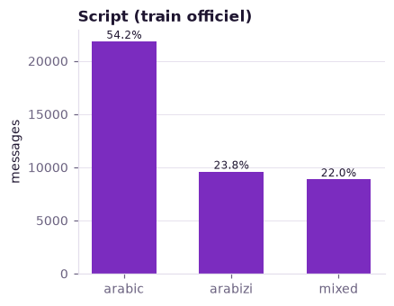

### Catégories

| category | train (%) | val (%) | test (%) |
|---|---|---|---|
| billing_payment | 11.4 | 11.4 | 10.6 |
| customer_care | 8.9 | 8.9 | 9.0 |
| devices | 3.9 | 3.9 | 4.1 |
| home_internet | 9.0 | 9.0 | 9.3 |
| home_line | 9.4 | 9.4 | 9.3 |
| mobile_money | 6.5 | 6.4 | 6.8 |
| network_calls | 10.8 | 10.9 | 10.6 |
| out_of_scope | 1.4 | 1.3 | 1.4 |
| plans_subscription | 11.6 | 11.6 | 12.1 |
| prepaid_credit | 6.9 | 6.9 | 6.6 |
| sim_line | 11.2 | 11.2 | 10.8 |
| usage_mobile_data | 9.1 | 9.0 | 9.5 |

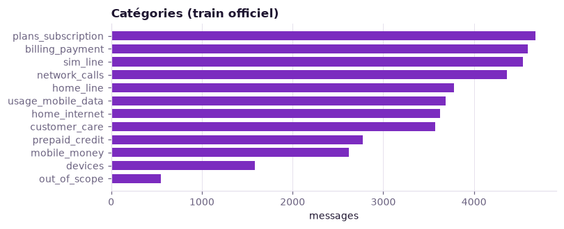

### Intentions

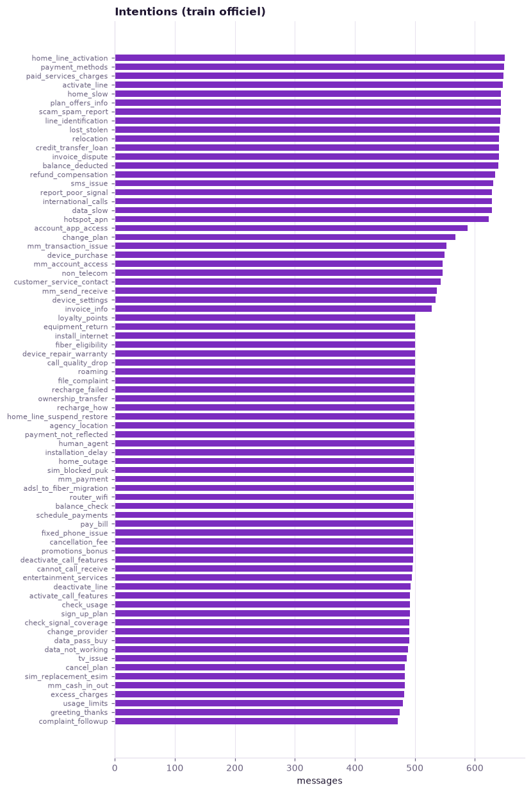

### Produit

| product | train (%) | val (%) | test (%) |
|---|---|---|---|
| digital_services | 1.2 | 1.2 | 1.4 |
| fixed_phone | 2.7 | 2.8 | 4.0 |
| home_adsl | 1.8 | 1.9 | 1.4 |
| home_box_4g_5g | 2.0 | 1.8 | 2.3 |
| home_fiber | 8.7 | 8.8 | 8.6 |
| mobile_broadband | 1.0 | 1.1 | 1.2 |
| mobile_money | 6.7 | 6.7 | 6.9 |
| postpaid_mobile | 12.7 | 12.9 | 9.8 |
| prepaid_mobile | 12.7 | 12.7 | 11.5 |
| tv | 1.8 | 1.8 | 1.8 |
| unknown | 48.7 | 48.3 | 51.2 |

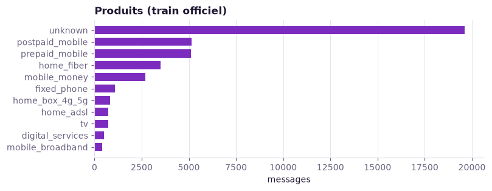

### Urgence et needs_human

| urgency | train (%) | val (%) | test (%) |
|---|---|---|---|
| 0 | 48.3 | 48.8 | 50.3 |
| 1 | 29.2 | 29.0 | 24.5 |
| 2 | 19.4 | 19.2 | 21.6 |
| 3 | 3.0 | 3.1 | 3.6 |

| needs_human | train (%) | val (%) | test (%) |
|---|---|---|---|
| False | 84.8 | 85.3 | 87.3 |
| True | 15.2 | 14.7 | 12.7 |

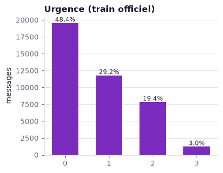
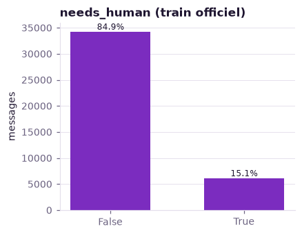
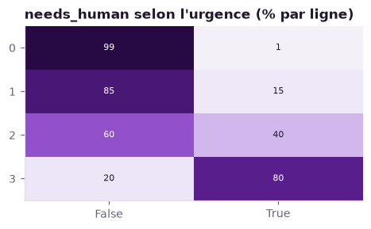

### Générateur et ronde

| generator | train (%) | val (%) | test (%) |
|---|---|---|---|
| claude-opus-5.5 | 77.6 | 77.6 | 100.0 |
| gemini-3.8-flash | 4.9 | 5.0 | 0.0 |
| gemini-4-argon | 17.5 | 17.4 | 0.0 |

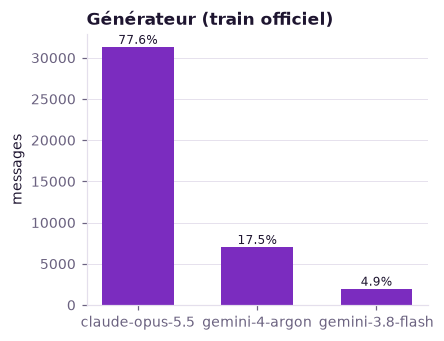
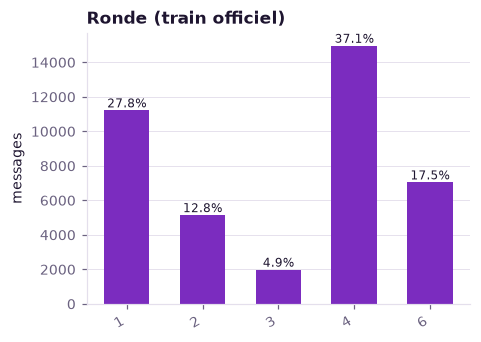

## 5. Longueurs

| split | moyenne | médiane | min | max |
|---|---|---|---|---|
| raw_train | 74.8 | 74.0 | 4 | 247 |
| raw_test | 71.7 | 70.0 | 10 | 184 |
| final_train | 74.8 | 74.0 | 4 | 247 |
| final_val | 75.0 | 74.0 | 6 | 214 |
| final_test | 71.7 | 70.0 | 10 | 184 |

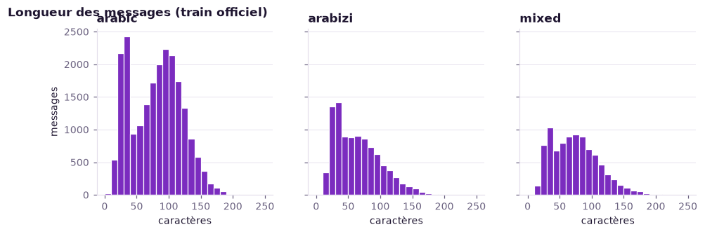

## 6. Co-occurrences

Chaque intention appartient à une seule catégorie (diagonale par blocs) :

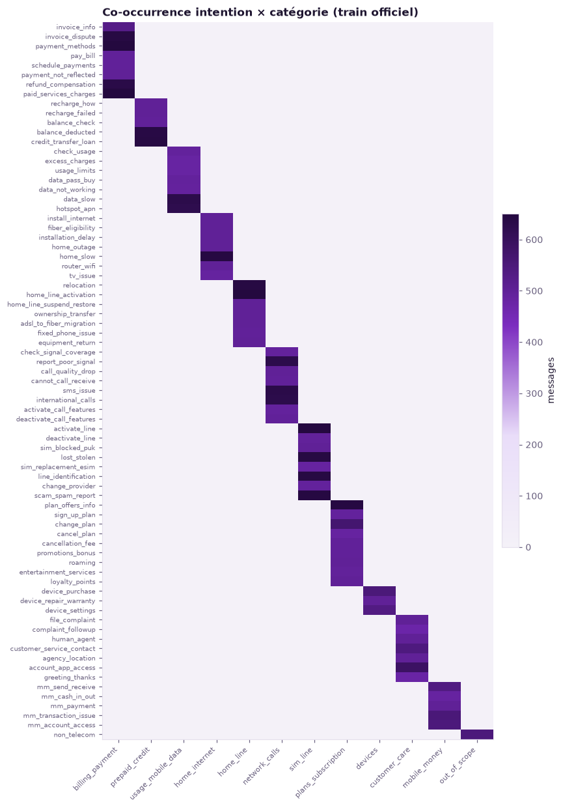

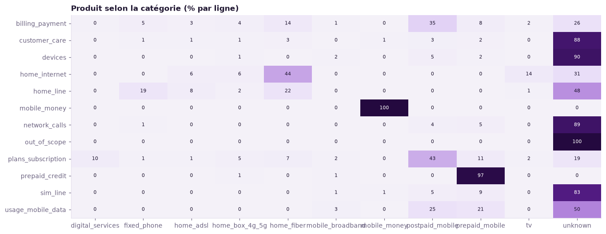

## 7. Détecteur de script heuristique (informatif)

Exactitude sur le train officiel : **89.60%**. La frontière arabizi / mixte est floue dans les données (beaucoup de messages arabizi contiennent des mots français isolés) ; le détecteur n'est utilisé que pour le contrôle de cohérence.

| label | arabic | arabizi | mixed |
|---|---|---|---|
| arabic | 21796 | 0 | 66 |
| arabizi | 0 | 6571 | 3037 |
| mixed | 375 | 721 | 7791 |

